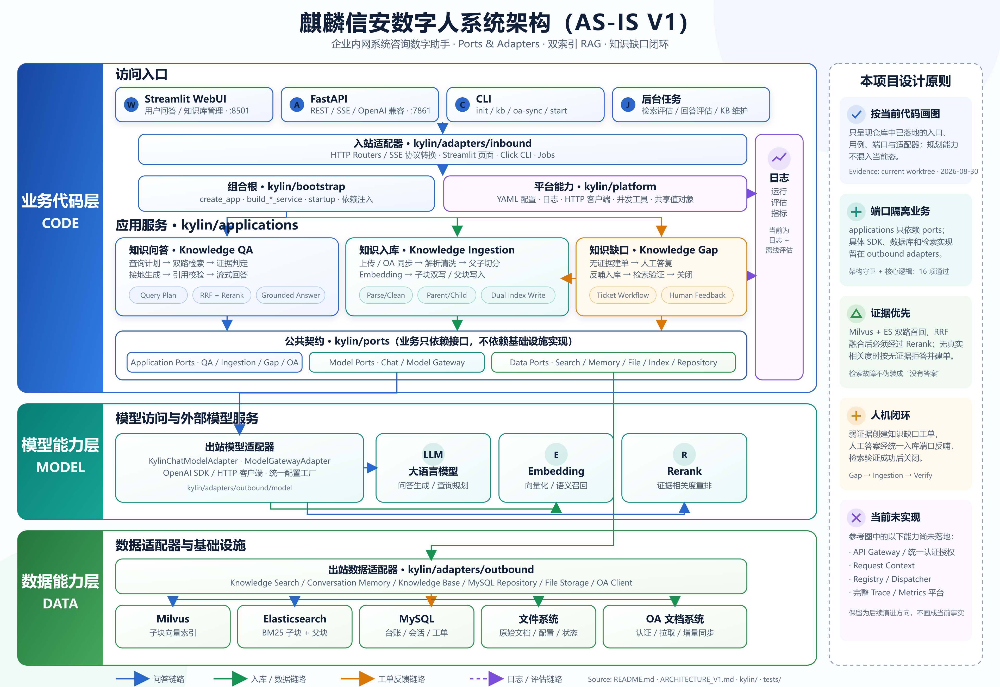

# 麒麟信安数字人系统架构图说明

## 图与参考样式的对应关系

| 参考图概念 | 本项目真实落点 | 当前状态 |
|---|---|---|
| OA / Web / API | Streamlit WebUI、FastAPI、Click CLI、后台评估任务 | 已实现 |
| API 网关、AuthN/AuthZ、Request Context | 当前仓库没有统一实现 | 未画入当前态 |
| Application Runtime Core | `kylin/bootstrap` 直接完成实例化和依赖注入 | 已实现；没有 Registry / Dispatcher |
| 应用插件 | Knowledge QA、Knowledge Ingestion、Knowledge Gap 三个应用服务 | 已实现 |
| Shared Contracts / Ports | `kylin/ports/application`、`model`、`data` | 已实现 |
| Model Access Layer | `kylin/adapters/outbound/model` | 已实现 |
| LLM / Embedding / Rerank | `model_settings.yaml` 配置的外部模型服务 | 已实现 |
| Data Access Layer | 搜索、会话记忆、知识库、MySQL、文件与 OA 出站适配器 | 已实现 |
| Milvus / Elasticsearch / MySQL / 文件 | 双索引、台账、会话、工单、原始文档与状态 | 已实现 |
| 日志 / 链路追踪 / 评测埋点 | 日志与离线检索/回答评估 | 部分实现；完整 Trace / Metrics 未实现 |

## 三条核心业务链路

1. **问答链路**：FastAPI / WebUI → Knowledge QA → Query Plan → Milvus + Elasticsearch 双路检索 → RRF → Rerank → 证据门 → LLM 接地生成与引用校验 → SSE / REST 返回。
2. **入库链路**：HTTP 上传 / CLI / OA 同步 → Knowledge Ingestion → 解析、清洗、父子切分 → Embedding → Milvus 子块向量索引 + Elasticsearch 子块/父块索引；MySQL 和文件系统保存台账与原文。
3. **知识缺口闭环**：无证据拒答 → 创建工单 → 人工答案 → 统一 Knowledge Ingestion Port 反哺 → 检索验证 → 关闭工单。

## 架构核验

范围为当前工作树的 `kylin/`、`tests/`、`README.md` 与 `ARCHITECTURE_V1.md`。结论为 **SHIP（适合作为当前态架构图）**：应用层到端口的依赖方向清楚，组合根集中，三条纵向业务链路均能在代码中追溯。

无外部服务的 `unittest` 回归共 16 项通过，包括依赖方向守卫、HTTP 模型端口守卫、应用端口契约、查询计划降级、RRF、父子切分和引用校验。完整 `pytest`、Docker 启动及外部 MySQL / Milvus / Elasticsearch / 模型服务集成未在本次制图校验中执行。

SVG 是可编辑源文件；PNG 为 2× 分辨率导出，适合直接放入 README、汇报材料或设计文档。
